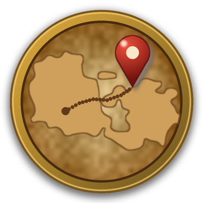

# Waymark

*Formerly Battlefield Info.*

**The small Battlefield Map, turned into the map you actually play with.**

Waymark builds on the game's own Battlefield Map (Shift-M): the small map you can keep open while you play. It adds quests, townsfolk, rares, gathering nodes and exploration to it, and lets you size, zoom and style it however you like. It's an exploration aid in the classic spirit: it shows you the world and leaves the route to you.

## On the map

- **Quests:** quest givers, turn-ins and objective spots, plus the game's own objectives and quest areas. Quests you pick up from givers the database doesn't know about are learned as you play.
- **Quest tracker and quest window:** a tracker attached to the map, sorted by distance, level or area, and a full quest log.
- **Towns and cities:** Townsfolk and an automated system for switching between town-view, city-view and cave-view. Changes made in either context is kept to that context.
- **Rares and treasures** (with RareScanner), **gathering nodes** (with GatherMate2)
- **Dungeons and caves:** dungeon entrances on the world, a dungeon's own map while you're inside, and cave maps either art or minimap detail when youre inside.
- **Exploration:** show unexpored in different styles you want
- **Your group:** party and raid members in class colours, a line to your target (friendlies only).

## The map itself

- Resize it, move it, zoom it in and out, and switch to a large mode.
- Close-up detail when you zoom in near. (or at any zoom if you choose)
- Zoom out for continent view, seamless.
- Header and border styles to choose from: classic plate, parchment, leather, stone, gold, wood and more.

- Every layer has its own switch, opacity and size, and a row of toggle buttons on the map that you pick and order yourself.
- **Context profiles:** different layers in combat, battlegrounds, dungeons, towns or while gathering, or hide the map there.
- **Saved setups:** keep several complete setups and switch between them; each character can use its own.
- Key bindings also!
- 
## Installing

**From CurseForge:** install *Waymark: Battlefield Map* with the CurseForge app (formerly Battlefield Info: existing installs update by themselves).

**By hand:** download `Waymark-Forever-1.2.1.zip` from the [latest release](../../releases/latest) and unzip it into
`World of Warcraft\_forever_\Interface\AddOns\`, so you end up with `AddOns\Waymark\Waymark.toc` and `AddOns\BattlefieldInfo\`
(a small helper that carries 1.x settings over; it can be deleted once each character has logged in with Waymark).

**From git:** copy this repository's `Waymark` and `BattlefieldInfo` folders into your AddOns folder.

The latest release and this branch are for **WoW Forever** (interface 16001). For **Classic Era** (interface 11509), get `Waymark-Era-1.2.0.zip` from [its release](../../releases/tag/v1.2.0-era) and unzip it into `World of Warcraft\_classic_era_\Interface\AddOns\`; it has a third folder, `Waymark_Nodes`. The Era files are on the [`era` branch](../../tree/era).

## Getting started

- Open the map with **Shift-M** (the game's own key).
- **/bfi** opens the settings. The gear on the map opens a quick panel with the most-used switches.
- Fonts and textures from SharedMedia are picked up if you have it.

## Works with

All optional; the map works without them:

- **QuestieDB** or **Questie**: quest givers, turn-ins and objective spots (needed for these layers)
- **RareScanner**: rares and treasures
- **GatherMate2**: gathering nodes
- **TomTom**: waypoints
- **SharedMedia**: more fonts and textures

## Bugs and ideas

Open an [issue](../../issues). For a bug, say what you did, what you saw, and which other map or quest addons you run.
`/waymark check` prints a self-test to chat that helps.

## Credits

Cave and dungeon map data come from [OpenMap](https://www.curseforge.com/wow/addons/openmap) (MIT licence). Waymark's code is MIT licensed. Almost everything you see from the game is drawn from your own client; the exceptions are the baked continent patches and sea lettering (Media/ZoneCloneArt, Media/ZoneShapes/Forever/letters), derived from Blizzard's map art and not covered by the MIT licence (see LICENSE).

See [LICENSE](LICENSE) and [CHANGELOG](CHANGELOG.md).
